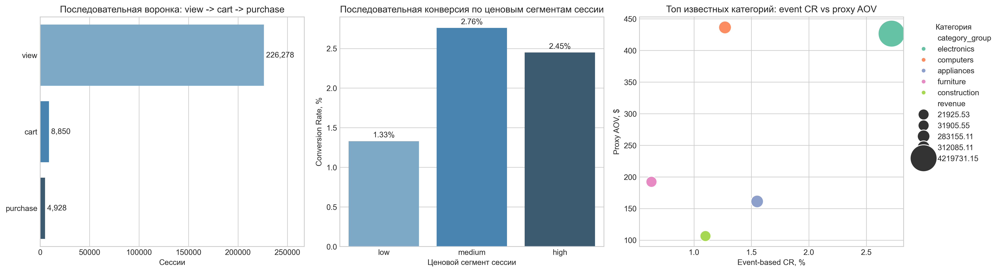
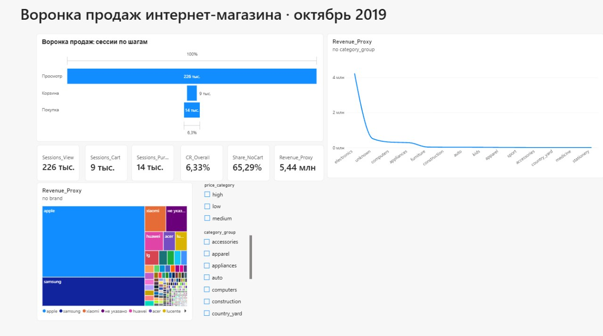

# E-commerce Funnel & User Behavior Analysis

Продуктовая аналитика воронки conversions на публичном датасете интернет-магазина (1 млн событий, октябрь 2019). Задача — не просто посчитать CR, а найти, где и почему пользователи теряются, и перевести находки в проверяемые гипотезы с оценкой денег.

## TL;DR

- Пересчитал воронку по хронологии событий внутри сессии и обнаружил, что **65% покупок проходят мимо корзины** — то есть корзина не обязательный этап, а один из двух путей. Это переписало вывод первой версии, где наивный `purchase / cart` давал бессмысленные 160%.
- Настоящая последовательная конверсия `view → cart → purchase` = **2.18%**, а шаг `cart → purchase` = **55.68%**: корзину дожимают нормально, узкое место — дотянуть пользователя до корзины (**3.91%** от просмотров).
- Лидер выручки — `electronics` (**77.6%** выручки выборки); `computers` — зона упущенной выручки: чек $436 при конверсии 1.27% и почти неиспользуемой корзине.
- Собрал три продуктовые гипотезы с оценкой эффекта и честными оговорками (что прокси, что только через A/B).

## О проекте и задаче

Исследовал поведение пользователей в интернет-магазине на выборке из 1 млн событий. Хотел понять три вещи: как человек идёт от просмотра к покупке, где основные потери, и есть ли дыры в самих данных, которые ломают метрики. Третий пункт оказался самым интересным — к нему и сводится главная находка работы.

## Главное, что я нашёл (и как к этому пришёл)

Первую версию воронки я считал по факту наличия событий в сессии: сколько сессий видели `view`, сколько `cart`, сколько `purchase`. И там вылезла странность — сессий с покупкой оказалось больше, чем сессий с корзиной (14 316 против 8 894), а отношение purchase/cart переползло за 160%. Для нормальной воронки так быть не может.

Я не стал это «закрашивать» и пошёл проверять по времени: собрал воронку как первый `view` → `cart` после него → `purchase` после этого `cart`, и параллельно посчитал покупки, которые вообще не трогали корзину. Оказалось, что из всех сессий с покупкой после просмотра **9 221 (65.17%) купили напрямую**, минуя `cart`. Подтверждение нашлось и по категориям: в `computers` на 56 160 просмотров приходится всего 144 события корзины, а в `apparel` и `sport` корзин нет вовсе.

То есть старая «аномалия 160%» была не багом чтения, а признаком реального сценария (быстрый checkout) и/или неполного логирования корзины. Отсюда отдельная рекомендация — проверить instrumentation, прежде чем «оживлять» корзиночную воронку: если покупки и правда идут в один клик, усилия направлялись не туда; если теряются события — это искажает любые будущие выводы. Мне кажется, именно этот ход (споткнуться → не игнорировать → пересчитать → переписать вывод) и есть основная ценность работы, а не сами цифры.

## Ключевые метрики

| Что | Значение | Комментарий |
|---|---|---|
| Последовательная воронка `view→cart→purchase` | 226 278 → 8 850 → 4 928 сессий | overall CR **2.18%** |
| Шаг `cart → purchase` | **55.68%** | корзину дожимают хорошо, провал не здесь |
| Шаг `view → cart` | **3.91%** | вот где реальное узкое место |
| Покупки без корзины | 9 221 из 14 149 (**65.17%**) | второй путь, не ошибка данных |
| Медиана «первый view → покупка» | **2.83 мин** | P25/P75: 1.33 / 6.15 мин |
| Медиана полной длительности сессии с покупкой | **3.95 мин** | отдельная метрика, не путать с предыдущей |
| Ценовые сегменты сессии (CR) | low **1.33%** / medium **2.76%** / high **2.45%** | сегменты взаимоисключающие, по макс. цене в сессии |
| `electronics` | CR 2.72%, proxy AOV $426.67, **77.6%** выручки | основной бизнес |
| `computers` | CR 1.27%, proxy AOV $436.48, $312K выручки | высокий чек, низкая конверсия, мёртвая корзина |
| `unknown` | **31.8%** событий, 9.3% выручки | ограничивает категорийные выводы |

## Что смотреть на графике



Три панели слева направо: (1) последовательная воронка — видно, что после корзины падение уже не критичное, а основной обвал на входе в корзину; (2) конверсия по ценовым сегментам сессии — `medium` лидирует, `low` отстаёт примерно вдвое; (3) известные категории в координатах event-CR / proxy-AOV, размер пузыря — выручка, тут `computers` наглядно сидит высоко по чеку и низко по конверсии.

## Рекомендации и оценка эффекта

**BNPL / рассрочка для `computers`.** Дорогой чек и низкая конверсия — классический кандидат на оплату частями прямо в карточке. На объёме выборки подъём event-CR на +0.5 п.п. (с 1.27% до ~1.77%) даёт порядка +281 покупки и ориентировочно **+$120–125K** дополнительной выручки. Считаю это прокси-оценкой, не обещанием: точный эффект только через A/B и с учётом стоимости финансового продукта.

**Low-сегмент: порог доставки и кросс-селл.** Разрыв с `medium` ~1.4 п.п. и по входу в корзину, и по дожатию похож на барьер «невыгодно из-за доставки». Проверять порог бесплатной доставки и подсказки «добавьте ещё на $X». Денежный эффект сознательно не обещаю: нет среднего чека по ценовым сессиям, поэтому гипотеза качественная и измеряется тестом, а не расчётом.

**Проверить корзину как явление.** 65% покупок мимо неё и нулевые корзины в части категорий — это либо реальный быстрый checkout, либо потеря событий `cart`. Прежде чем что-то менять в воронке, надо понять, какой случай: это вопрос к аналитике данных, а не к продукту.

## Какие навыки здесь видно

Не список библиотек (стек и так ниже), а то, что обычно и проверяют на собеседовании по аналитике:

- **Критическая проверка метрик, а не слепой расчёт.** Я не принял странное 160% как данность и не стал его интерпретировать — пошёл искать причину в структуре данных и пересобрал воронку по порядку событий.
- **Разделение session-based и event-based метрик** и явное подписание, где что считается, чтобы не сравнивать несравнимое.
- **Аккуратная сегментация.** Ценовой сегмент назначен сессии (по максимальной цене), а не событию, иначе одна сессия прыгала бы сразу в три группы.
- **Перевод находок в деньги с оговорками.** Где можно оценить эффект — оценил и назвал допущение; где нельзя (low-сегмент) — честно не придумал цифру.
- **Понимание разницы proxy и настоящей метрики.** AOV здесь — прокси по цене purchase-события, потому что нет `order_id` и количества товаров; я это проговариваю, а не выдаю за средний чек заказа.

## Дашборд (Power BI)

Интерактивный дашборд по тем же данным: `dashboard/power_bi_ecommerce.pbix`
(открывается в Power BI Desktop, он работает только на Windows).



**Что показывает**
- Воронка по шагам (просмотр → корзина → покупка) и конверсия по всей воронке: 6,33% (по наличию событий в сессии, без проверки порядка).
- Доля покупок мимо корзины: 65,29%.
- Выручка (прокси) по группам категорий и по брендам; фильтры по ценовой категории и группе категорий.

**Основные наблюдения**
- Самое большое падение — «просмотр → корзина»: 226 278 → 8 894 сессии (3,93%, падение 96,1%). При этом «покупка» (14 316) больше «корзины»: корзина не обязательный шаг, 65,29% покупок идут мимо неё. Строгая хронологическая воронка — в ноутбуке: 226 278 → 8 850 → 4 928, CR 2,18%.
- Корзина — сильный сигнал намерения: последовательная конверсия cart → purchase 55,68%, против 6,33% по всем сессиям с просмотром.
- Выручка сконцентрирована: electronics — 77,6% прокси-выручки, unknown — 9,3%, computers — $312K при proxy AOV $436.48 и event-CR 1,27% (144 события корзины на 56 160 просмотров — корзина почти не используется). По брендам лидируют Apple и Samsung, далее Xiaomi и Huawei; отдельная группа «не указано» — бренд заполнен не всегда.
- Ценовые сегменты сессии конвертируются по-разному: medium 2,76%, high 2,45%, low 1,33% (разрыв medium–low 1,43 п.п.). На дашборде срезы проверяются фильтром price_category.

**Определения метрик**
- `CR_Overall` = Sessions_Purchase / Sessions_View = 14 316 / 226 278 = 6,33% — доля сессий с покупкой среди сессий с просмотром по наличию событий (уникальные `user_session`). Не путать с последовательной конверсией 2,18% из ноутбука.
- `Share_NoCart` = сессии с `purchase`, где в той же сессии не было `cart` / все сессии с `purchase` = 65,29%. В ноутбуке 65,17% (9 221 из 14 149) — там знаменатель ограничен покупками после просмотра.
- `Revenue_Proxy` = сумма `price` по событиям `purchase` (одно событие = одна позиция). Прокси, а не выручка: нет `order_id` и количества товаров, скидок, возвратов и доставки, плюс это выборка, а не полный трафик. Подходит для сравнения структуры (категории, бренды), не для финансовых итогов.

## Ограничения (честно)

- Нет нормального `order_id` и количества товаров → AOV это proxy, не настоящий чек.
- Выборка обрезана до 1 млн событий → часть сессий обрывается на середине пути (покупка без предшествующего просмотра и т.п.).
- `unknown` занимает ~31.8% событий → категорийная картина неполная, выводы в основном про товары с известной категорией.
- Категорийные метрики event-based и не сравнимы напрямую с сессионной воронкой.

## Стек и структура

Python, Pandas, NumPy, Matplotlib, Seaborn, Kaggle Hub / Kaggle API, Jupyter Notebook.

```text
ecommerce-funnel-analysis/
├── notebooks/
│   └── funnel_analysis.ipynb
├── images/
│   └── funnel_and_category_analysis.png
├── .gitignore
├── requirements.txt
└── README.md
```

## Как запустить

```bash
git clone https://github.com/ankeew/ecommerce-funnel-analysis.git
cd ecommerce-funnel-analysis
pip install -r requirements.txt
jupyter notebook notebooks/funnel_analysis.ipynb
```

Ноутбук сначала проверяет локальный `ecommerce_sample.csv`; если его нет — тянет датасет через Kaggle Hub (нужен `kaggle.json`). Данные публичные, синтетические-реальные с Kaggle, никакого NDA-слива здесь нет — это pet-проект под портфолио.
